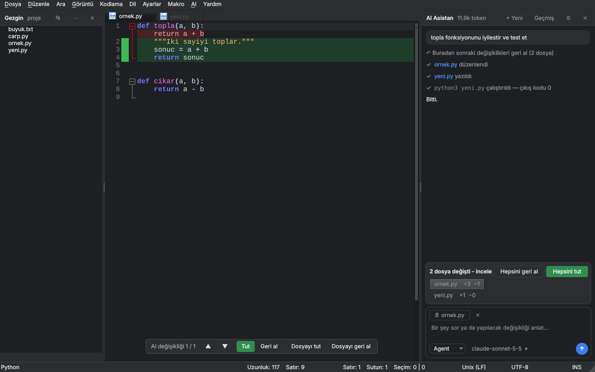

# NotepadAI

**Notepad++ hissinde, AI agent'ı ve dosya yöneticisi gömülü, hafif ve çapraz platform (Windows / Linux / macOS) kod editörü.**

[Notepad Next](https://github.com/dail8859/NotepadNext) (Notepad++'ın Qt ile yeniden yazılmış hali) üzerine kurulmuş bir forktur. Amaç: Antigravity / Cursor gibi AI IDE'lerin işlevini, Electron ağırlığı olmadan, Notepad++ hızında sunmak.



## Windows'a kurulum

1. **[Releases](https://github.com/onurbaydas/NotepadAI/releases/latest)** sayfasından `NotepadAI-...-Windows-Setup.exe` dosyasını indir
   (ARM işlemcili bilgisayarlar için `...-Windows-ARM64-Setup.exe`, kurulumsuz kullanım için `...-Windows-Portable.zip`)
2. Çalıştır. Windows **"Windows kişisel bilgisayarınızı korudu"** uyarısı verirse: **Ek bilgi → Yine de çalıştır**
   (uygulama henüz kod imzalı değil, bu yüzden SmartScreen tanımıyor)
3. Kurulum bitince Başlat menüsünden **NotepadAI**'ı aç
4. *File → Open Folder as Workspace* ile proje klasörünü aç
5. Sağdaki AI panelinde **Settings** → **Sign in with OpenRouter (browser)** ya da kendi API anahtarın (aşağıya bak)

Linux için `.AppImage`, macOS için `.dmg` dosyaları da aynı sayfada.

## Özellikler

- 🤖 **Agent modu** (Cursor / Antigravity gibi): AI projeyi kendisi keşfeder, dosyaları okur, düzenler, yeni dosya oluşturur ve komut çalıştırır
  - Araçlar: `list_files`, `read_file`, `search`, `edit_file`, `write_file`, `run_command`
  - Agent beklemeden çalışır; değişiklikler **editörde satır içi diff** olarak görünür (eklenen satırlar yeşil, silinenler kırmızı)
  - Alttaki çubukla değişiklikler arasında gezilir, her biri **Tut / Geri al**; sohbette "N dosya değişti · Hepsini tut / Hepsini geri al" şeridi
  - Terminal komutları sohbetin içinde **Çalıştır / Atla** kartıyla onaylanır; AI sadece çalışma klasörünün içine erişebilir
  - `@dosya` yazarak dosyaları bağlama ekle; projedeki `AGENTS.md`, `CLAUDE.md`, `.cursorrules` otomatik okunur
- ↶ **Checkpoint**: her mesajın altındaki *Buradan sonraki değişiklikleri geri al* ile o mesajdan sonraki tüm dosya değişiklikleri geri alınır
- ✏️ **Satır içi düzenleme** (`Ctrl+I`): kodu seç, ne istediğini yaz; sonuç editörde diff olarak gelir, Tut / Geri al
- 👻 **Yazarken öneri** (ghost text): yazmayı bırakınca gri öneri çıkar, **Tab** ile tamamı, **Ctrl+→** ile kelime kelime kabul
- 🎨 **Sade arayüz**: Cursor tarzı sohbet paneli (mesaj kartları, *Kopyala / Editöre ekle* butonlu kod blokları, tek satırlık adım özetleri), mesaj kutusunda **Agent / Sohbet** seçimi ve model adı, gönderilecek dosyayı gösteren etiket; Türkçe arayüz
- 💬 **Sohbet geçmişi**: sohbetler otomatik kaydedilir, **History** ile geri açılır
- 🧠 **Bağlam yönetimi**: uzun agent oturumlarında eski araç çıktıları otomatik kısaltılır, gerekirse en eski mesajlar atılır
- 💸 **Prompt caching** (Claude): tekrar gönderilen bağlam önbellekten okunur, maliyet ve gecikme ciddi düşer; kullanılan token sayısı panelin üstünde görünür
- 🌙 **Koyu tema** (varsayılan, *View → Dark Theme* ile kapatılabilir); tüm diller için sözdizimi renkleri otomatik koyulaştırılır
- 🔌 **Claude**, **OpenAI**, **OpenRouter** (tarayıcıdan giriş), **Ollama** ve tüm OpenAI-uyumlu servisler; yanıtlar canlı akar
- 📁 **Dosya yöneticisi** (Folder as Workspace) varsayılan olarak açık
- ✍️ Notepad++'tan alışık olunan her şey: Scintilla editörü, sözdizimi renklendirme, makrolar, çoklu imleç, arama/değiştirme, Lua betikleri

## Kısayollar

| Kısayol | İşlev |
|---|---|
| `Ctrl+L` | AI sohbet kutusuna git |
| `Ctrl+I` | Seçili kodu AI ile düzenle |
| `Tab` / `Ctrl+→` | Gri öneriyi kabul et / bir kelimesini kabul et |
| `Enter` | Sohbette mesaj gönder (`Shift+Enter`: yeni satır) |
| `Ctrl+Shift+I` | AI panelini aç/kapat |

Hepsi menü çubuğundaki **AI** menüsünde de var.

## AI'a bağlanma

**AI → AI Settings** (veya paneldeki **Settings**):

| Yöntem | Nasıl | Not |
|---|---|---|
| **OpenRouter (tarayıcıdan giriş)** | *Sign in with OpenRouter* → tarayıcıda giriş yap → otomatik bağlanır | API anahtarı kopyalamak yok. Claude, GPT, Gemini, DeepSeek... hepsi tek hesapla. Kullandıkça öde (kredi yüklenir) |
| Claude | Provider: Anthropic, anahtar: [console.anthropic.com](https://console.anthropic.com) | Prompt caching ile en ucuz Claude kullanımı |
| OpenAI | Provider: OpenAI-compatible, URL `https://api.openai.com/v1` | |
| **Ollama (yerel, ücretsiz)** | [ollama.com](https://ollama.com)'u kur, `ollama pull qwen2.5-coder`, URL `http://localhost:11434/v1` | İnternet ve hesap gerekmez; hız bilgisayarına bağlı |

- **Autocomplete model**: yazarken öneriler için hızlı/ucuz model (Claude için varsayılan `claude-haiku-5-5`). Boş bırakılırsa ana model kullanılır.
- Agent modu için araç çağırmayı (tool calling) destekleyen bir model gerekir.

> ℹ️ **Claude Pro/Max veya ChatGPT Plus aboneliğiyle giriş** yapılamıyor: Anthropic ve OpenAI, tüketici aboneliklerinin üçüncü parti uygulamalarda kullanılmasına izin vermiyor. Tarayıcıdan giriş isteyenler için en iyi yol OpenRouter.

> ⚠️ API anahtarı yerel ayar dosyasında düz metin olarak saklanır (Windows'ta `%APPDATA%\NotepadAI\NotepadAI.ini`).

## Kaynaktan derleme

Gerekenler: Qt 6.5+ (Core, Gui, Widgets, Network, PrintSupport, Core5Compat), CMake 3.21+, C++20 derleyici.

```bash
# Ubuntu / Debian
sudo apt install qt6-base-dev qt6-base-private-dev qt6-5compat-dev qt6-tools-dev qt6-tools-dev-tools qt6-l10n-tools libgl-dev ninja-build cmake g++

cmake -S . -B build -G Ninja -DCMAKE_BUILD_TYPE=Release
ninja -C build
./build/src/NotepadNext
```

Windows/macOS için ayrıntılı talimatlar: [doc/Building.md](doc/Building.md)

## Yol Haritası

- [x] Agent modu, diff onayı, checkpoint
- [x] Satır içi düzenleme, yazarken öneri
- [x] Sohbet geçmişi, bağlam yönetimi, prompt caching
- [x] Koyu tema, OpenRouter ile tarayıcıdan giriş
- [x] Yeni sohbet paneli tasarımı, Türkçe arayüz
- [x] Editörde satır içi diff, sohbet içi komut onayı, `@dosya`, proje kuralları
- [ ] Gömülü terminal paneli
- [ ] LSP (tanıma git, hata altı çizgileri), Git arayüzü
- [ ] API anahtarını işletim sisteminin anahtar zincirinde saklama

## Lisans

GPL-3.0. Orijinal Notepad Next © Justin Dailey ve katkıda bulunanlar. Orijinal README: [doc/NotepadNext-README.md](doc/NotepadNext-README.md)
